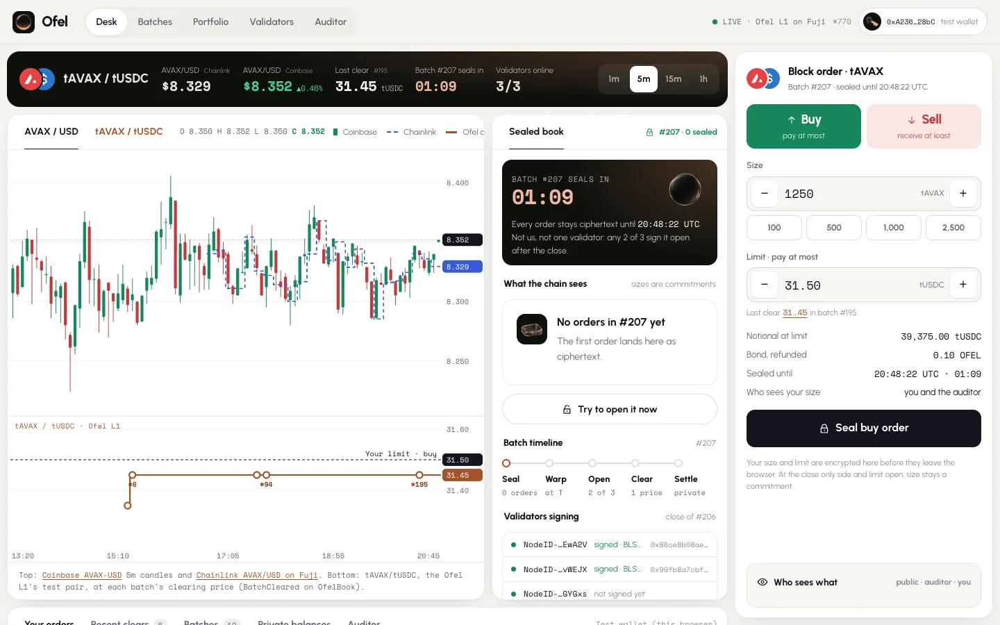
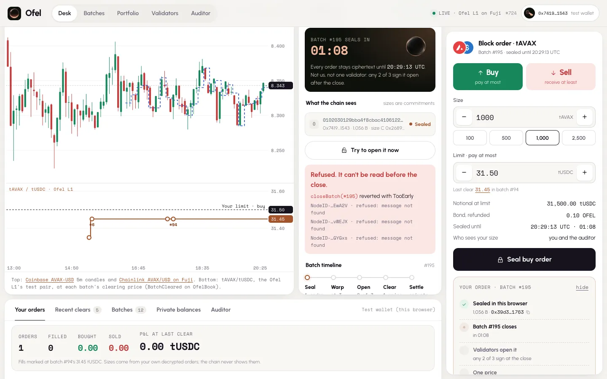
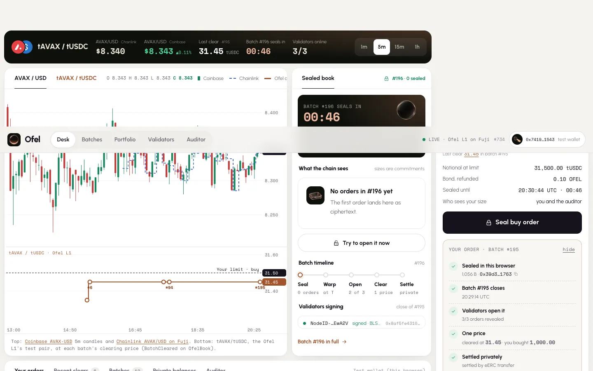

# Ofel

**Trade size without being front-run.** Private block trading for funds, DAOs and treasuries: your order stays sealed
until the batch closes, and your size is never made public. On its own Avalanche L1.

Ofel (Hebrew אופל, "deep darkness") is a sealed-batch trading desk for funds, DAOs and treasuries that move size and
don't want to be front-run or watched. It runs on its own Avalanche L1. The batch seal is held by that L1's validators,
not by an operator, and balances and fills live in Ava Labs' encrypted ERC (eERC), which has an auditor key for
compliance.

> **Live on Fuji.** The Ofel L1 is a real Fuji L1 (subnet
> [`soDva7N7…`](https://subnets-test.avax.network/subnets/soDva7N79urhP1jb4SM8Av8XcmDQgnpfGTLjqdx8mnYDVXMKt),
> chain ID 77077, token OFEL) with three PoA validators on our VPS, and the desk is at
> **https://ofel-desk.vercel.app**. A judge with an empty wallet picks **Connect → Test wallet**, taps **Get test funds**
> (OFEL gas and test assets from the Ofel faucet contract on the L1, so no Fuji AVAX is needed), and can seal an order
> right away. A house wallet quotes blind into any batch you trade in, ±0.15% around Chainlink's AVAX/USD on Fuji,
> so your order has a counterparty at the market price. It splits its liquidity into 3-5 sealed orders per side with
> random sizes, and some of its bids sit above some of its asks, so every batch mixes several orders on each side:
> the public buy and sell totals never equal one trader's size (`packages/ofel/src/ladder.ts`; a 1,000 tAVAX order
> at Chainlink ±0.5% fills in full and lands among at least two orders per side). Totals are public, single sizes aren't.

> **Prior work:** the desk UI is forked from Eidolon (Total Recall, Nov 2026), the same author's trading terminal: its
> design system (tokens, Urbanist + Space Mono, cards, buttons, tables) and terminal layout (night market bar, chart,
> centre panel, order ticket, tabbed tables). Everything wired to it here (the sealed book, the batch timeline, the
> validator signatures, eERC balances, settlement and the auditor view) and every contract, circuit and the warplock
> library are Ofel's own. The candle and Chainlink helpers are ported from Kumi (same author).

## The desk

A trading terminal on Eidolon's UI base: AVAX-USD candles from Coinbase with Chainlink's Fuji feed behind them and
each Ofel batch's clearing price as a dot on the same scale, the sealed book in the middle, the block-order ticket on
the right. The house quotes ±0.15% around Chainlink AVAX/USD from batch #210 on (`houseQuote` in
`deployments/fuji-l1.json`); batches before that cleared against a fixed ~31 tUSDC test quote, so the desk keeps them
in the Batches tab and off the chart and P&L.



| Try to open it early: refused by the contract and every validator | After the close: one price, settled privately |
|---|---|
|  |  |

Phone: [docs/screens/desk-375.webp](docs/screens/desk-375.webp) · landing: [docs/screens/landing-1440.webp](docs/screens/landing-1440.webp)

## Compared with other venues

Ofel competes with on-chain order books and perps venues, AMMs and the private-trading designs. The landing's
"Compared" section shows this table with the same sources. Every row is from the venue's own docs or published research,
checked on Nov 14, 2026.

| Venue | Your order before it fills | Your size after it fills | Who can peek, or whom you trust | Price | Sources |
|---|---|---|---|---|---|
| Hyperliquid (order book on its own L1) | Public book; open orders readable by address | Public: size, price and both addresses | Its validators; anyone reads the book | Continuous order book | [1] [2] |
| dYdX v4 (order book appchain) | In every node's memory; public depth | Public trades feed | The block proposer (dYdX on MEV) | Continuous order book | [3] [4] |
| Dexalot (order book on its own Avalanche L1) | On-chain order book | On-chain fills | Its L1's validators | Continuous order book | [5] [6] |
| AMMs via a public mempool (Uniswap-style; LFJ on the C-Chain) | Pending swaps sit in the mempool | Public | Searchers can sandwich you | AMM curve | [7] [8] [9] |
| CoW Protocol (batch auction of intents) | Seen by solvers and the order API | The Trade event logs the amounts | Bonded solvers | Uniform price per batch | [10] [11] [12] |
| Shutter on Gnosis Chain (encrypted mempool; shuts down Nov 25, 2026) | Encrypted until inclusion | Decrypted and executed in the open | 4 of 7 keypers | Whatever app it feeds | [13] [14] [19] |
| Renegade (dark pool, MPC + ZK) | Hidden from the public; your relayer sees it | Hidden for internal matches | Your relayer | Pegged to the Binance midpoint | [15] [16] |
| Penumbra (shielded chain with a DEX) | Input amount burned publicly, identity shielded | Amounts public, not linked to you | No operator; sealed-bid swaps are "a future upgrade" | One price per block batch | [17] |
| Railgun (private balances, swaps via public DEXs) | The swap leg hits a public DEX | Amount visible, not linked to you | Broadcasters; the DEX leg is exposed | The external DEX's | [18] |
| **Ofel** | **Sealed until the close; opens only with 2 of 3 validator signatures** | **Never public: commitments, only totals** | 2 of 3 validators (today on one VPS); the clearing agent settles and audits | One price per batch | this repo |

**Ofel's trade-offs, plainly.** The seal is 2 of 3: two colluding validators could sign the close early, and all three
run on one VPS today, so in practice that is one operator. The clearing agent is trusted to settle the legs, submits
totals (checked on-chain against the commitments) and holds the auditor key. Side and limit become public at the close
so the price can be checked. Testnet only, and no on-chain range proof yet.

Sources:
[1] https://hyperliquid.gitbook.io/hyperliquid-docs/trading/order-book ·
[2] https://hyperliquid.gitbook.io/hyperliquid-docs/for-developers/api/info-endpoint ·
[3] https://docs.dydx.xyz/concepts/trading/limit-orderbook ·
[4] https://www.dydx.xyz/blog/update-on-mev ·
[5] https://github.com/Dexalot/contracts ·
[6] https://www.avalanche.com/blog/dexalot-launches-first-central-limit-order-book-subnet-on-avalanche-with-1m-in-incentives ·
[7] https://arxiv.org/abs/2009.14021 (Zhou et al., sandwich attacks) ·
[8] https://build.avax.network/blog/p2p-network-anomalies (C-Chain mempool contents pulled over gossip) ·
[9] https://github.com/lfj-gg/joe-docs (Liquidity Book is an AMM) ·
[10] https://docs.cow.fi/cow-protocol/concepts/introduction/batch-auctions ·
[11] https://raw.githubusercontent.com/cowprotocol/services/main/crates/orderbook/openapi.yml ·
[12] https://raw.githubusercontent.com/cowprotocol/contracts/main/src/contracts/GPv2Settlement.sol ·
[13] https://blog.shutter.network/shutterized-gnosis-chain-is-now-live/ ·
[14] https://docs.shutter.network/docs/shutter/research/the_road_towards_an_encrypted_mempool_on_ethereum ·
[15] https://docs.renegade.fi/concepts/privacy ·
[16] https://docs.renegade.fi/concepts/mpc-zkp ·
[17] https://protocol.penumbra.zone/main/dex/swap.html ·
[18] https://docs.railgun.org/wiki/learn/railway-dex-swaps ·
[19] https://blog.shutter.network/decommissioning-the-encrypted-mempool-on-gnosis-chain/

## How it works

1. **The seal: warplock.** Each batch has a close time T. The trader's browser encrypts the order to the exact bytes of
   the Avalanche Warp message that `OfelBook.closeBatch(batchId)` will emit at T:
   `UnsignedMessage(networkID, L1 chainID, AddressedCall(OfelBook, abi.encode(tag, batchId, T)))`.
   The scheme is identity-based encryption (Boneh–Franklin over BLS12-381, the same idea as tlock). Its "identity" is
   that message, and its key is a validator's BLS signature on it. Avalanche keys are min-pk with the POP ciphersuite, so
   a signature `sk·H(m)` *is* the IBE private key for `m`. A random secret is Shamir-split 2-of-3 across the validators'
   BLS keys, which the app reads live from the P-Chain, and the order is AES-GCM encrypted under that secret.
2. **The order can't be opened before T.** `closeBatch` reverts with `TooEarly` before T. Validators only sign Warp
   messages their chain has accepted, so before T `warp_getMessageSignature` answers "not found" on every validator.
3. **At T, anyone can open it.** Anyone calls `closeBatch`. The precompile emits the message, any 2 of the 3 validators
   sign it, and those signatures open every order. Reveals are checked on-chain against each order's commitment.
4. **One price.** The contract sets the uniform price from the revealed limits alone: bids are sorted high to low, asks
   low to high, and the price is the midpoint of the last crossing pair. It never needs anyone's size to find the price.
5. **Sizes stay private.** A size is never inside the part of the order that opens at T. Each order carries a Pedersen
   commitment on BN254, and the size goes to the clearing agent in a blob encrypted to the agent's x25519 key. That blob
   sits inside the timelock, so the agent can't read it before T either. At clearing the agent submits the buy and sell
   totals, and `OfelBook` checks `Σ C = total·G + blind·H` with the ecAdd/ecMul precompiles. Totals are public, and no
   single order's size ever is.
6. **Settlement is in eERC.** Each trader pays their leg to the clearing hub with a private eERC transfer, proven with
   Groth16 in the browser, and the hub pays out the other leg the same way. The eERC auditor key belongs to the clearing
   agent, so the auditor can decrypt every leg and every size, and only from T onward.
7. **One validator down.** The L1 uses `k=3, alpha=2` consensus parameters, so it keeps finalizing with 2 of 3
   validators. Warplock's threshold is the same 2 of 3.

### Who sees what

| | Public | Validators | Auditor / clearing agent | You |
|---|---|---|---|---|
| Your order before T | ciphertext | ciphertext | ciphertext | yes |
| Side and limit after T | yes | yes | yes | yes |
| Your size | never | never | from T | yes |
| Batch totals and price | yes | yes | yes | yes |
| Your eERC balance | never | never | yes | yes |

### Trust model (stated plainly)

- **Seal:** if 2 or more of the 3 validators collude, they could sign a close message off-chain before T. That is the same
  threshold the L1's own consensus relies on. A production set would be independent operators.
- **Clearing agent:** this role is trusted to settle the legs (the CCP model), to submit totals, and for any voids it
  declares. The totals themselves are verified on-chain against the commitments, and voids are logged. It cannot read
  orders before T. The agent is also the eERC auditor.
- **Not enforced on-chain (v2):** a range proof on committed sizes (today the agent voids out-of-range sizes off-chain),
  and delivery-versus-payment without a hub (this needs a custom eERC settlement circuit).
- A block proposer can skew `block.timestamp` by a few seconds. BLS and IBE are not post-quantum.

## Repository

| Path | What it is |
|---|---|
| `packages/warplock` | **warplock**, a reusable open-source TypeScript SDK that turns any Avalanche L1's validator set into a timelock. It has byte-exact Warp `UnsignedMessage`/`AddressedCall` encoding, CB58, IBE keyed by Avalanche BLS keys, Shamir over Fr, AES-GCM envelopes, and P-Chain and warp RPC readers. |
| `packages/ofel` | `@ofel/core`: order sealing, Pedersen commitments (matching `Pedersen.sol`), agent and self blobs, the clearing mirror and the ABIs. |
| `contracts/` | Foundry: `OfelBook.sol`, `Pedersen.sol`, test assets, and Ava Labs eERC vendored at upstream `8dc98cd` with its prod verifiers (Ecosystem License kept in `src/vendor/eerc/LICENSE.md`). |
| `scripts/` | `agent.ts` (clearing agent and auditor, plus the faucet relay API), `house.ts` (blind house quotes), `trader.ts` (CLI), `e2e.ts` (live suite), `spike.ts` (go/no-go), `eerc-setup.ts`, `topup.ts`, `topup-validators.sh` (P-Chain balances), `validator.sh` (stop or start one validator, local or Fuji), `qa/shots.mjs`. |
| `web/` | The desk, built with Vite and React: landing, Desk, Batches, Portfolio, Auditor, Validators. |
| `deployments/` | `fuji-l1.json` (Fuji L1 contract addresses, the e2e and hosted-run tx hashes), `fuji.json` (P-Chain txs, validators, balances and run-out dates), `local.json` (the local network), the L1 chain and subnet configs and the Fuji genesis. |
| `deploy/vps/` | Docker compose for the three Fuji validators, the clearing agent (with the faucet API) and the house on the VPS, and the avalanche-cli API shim. |

## Live deployment (Fuji)

| | |
|---|---|
| Desk | **https://ofel-desk.vercel.app** (production build, no keys in it; the Test wallet key is made in your browser) |
| Screen audit | every hosted route and state at 1440 and 375, before and after the ship round: [docs/SCREEN-AUDIT.md](docs/SCREEN-AUDIT.md) |
| L1 | subnet `soDva7N79urhP1jb4SM8Av8XcmDQgnpfGTLjqdx8mnYDVXMKt`, blockchain `29iRKcsUXYnLp4EFt2SAgKjn4AHFd8i7DS8CwXoeQ2mFHkL4pd`, Subnet-EVM v1.15.3, chain ID 77077, OFEL, Warp on, `k=3 α=2` |
| L1 RPC (warp API on) | `https://ofel-v{1,2,3}.201-18-198-162.sslip.io/ext/bc/29iRKcsUXYnLp4EFt2SAgKjn4AHFd8i7DS8CwXoeQ2mFHkL4pd/rpc` |
| Agent API | `https://ofel-api.201-18-198-162.sslip.io/api/health`, `POST /api/faucet` |
| Validator manager | PoA, proxy `0x0Feedc0de0000000000000000000000000000000`, owner `0x5Cc9…148f` |

| P-Chain tx (Avalanche Explorer) | |
|---|---|
| CreateSubnetTx | [soDva7N7…](https://subnets-test.avax.network/p-chain/tx/soDva7N79urhP1jb4SM8Av8XcmDQgnpfGTLjqdx8mnYDVXMKt) |
| CreateChainTx | [29iRKcsU…](https://subnets-test.avax.network/p-chain/tx/29iRKcsUXYnLp4EFt2SAgKjn4AHFd8i7DS8CwXoeQ2mFHkL4pd) |
| ConvertSubnetToL1Tx (3 validators) | [9E9JwtLh…](https://subnets-test.avax.network/p-chain/tx/9E9JwtLhCSSRGkfD5VwWhJuuAJxDUvhBQeQemf7HTdRbFPSw3) |
| Top-ups (ImportTx + 3× IncreaseL1ValidatorBalanceTx, twice) | listed in [deployments/fuji.json](deployments/fuji.json) `topups` |
| Hub → deployer on the C-Chain (Snowtrace) | [0xc65d950a…](https://testnet.snowtrace.io/tx/0xc65d950a1114ea7ed7f3212456b2cce5dc4af7b721b92e0e06c6362b0730c8b0), [0xb707a2db…](https://testnet.snowtrace.io/tx/0xb707a2db9c17d2409ee11c21c116af7fdcd5920d3c249c151b1e7b7b3ba86229) |

| Contract on the L1 | Address |
|---|---|
| OfelBook | `0x40Fb0a21A8736d3cE05008D33888FE207975D5aB` |
| EncryptedERC (Ava Labs, unmodified, converter, 2 decimals) | `0xaE10f3005c359cf6C68eaE6a245DcC4CF100DA21` |
| Registrar (eERC) | `0x3f6085124eC68Ea1BAD105b61c046d68F59B087F` |
| OfelFaucet (5 OFEL + 2,000 tAVAX + 50,000 tUSDC once per wallet, stocked for 200) | `0x9aF7eCC1dfD160556b7542A0eA4b37adeC0E0dDC` |
| tAVAX / tUSDC (test assets) | `0xc79eb2e7e25d053968d871f65f4bB5bD1Ddf7476` / `0xbAB44432a831383387eE19AaE227ae937CB020E7` |
| Clearing agent + auditor / house | `0x37727D010AEd8BFACD98A5D4D4C635cB20eDB4e8` / `0xFe2275fB49f0F5D5b2f07d2cF3D444a896cfda81` |

**Validator runway.** Each Fuji L1 validator pays 512 nAVAX per second (0.0442 AVAX a day) from its P-Chain balance.
Nick's 0.5 AVAX created the L1 (0.1664 each, fees 0.0002 AVAX), and two hub transfers (0.7 + 0.6) were exported to the
P-Chain and added evenly. Each validator now holds **0.5919 AVAX**, which lasts until about **2026-11-26 00:06 UTC**
for all three (`NodeID-4ofVdRcs…`, `NodeID-L4dJuAW1…`, `NodeID-9by3D2T4…`). The desk's Validators page shows the live
balance and date. To add more: `scripts/topup-validators.sh 0.3 "Ofel validators"` (requests AVAX from the funding hub,
exports C→P, imports, and spreads it with IncreaseL1ValidatorBalanceTx).

**Explorers.** P-Chain txs and the L1 itself are on the Avalanche Explorer (links above); hub transfers are on Snowtrace.
No hosted explorer indexes this L1's own EVM transactions (the Avalanche Explorer lists the L1 but not its blocks), so
the desk has its own explorer page, `https://ofel-desk.vercel.app/tx/<hash>`, which reads the public RPC and decodes the
calldata and events with the contracts' ABIs (linked from every order row in Batches), and every L1 tx hash in this README and in `deployments/fuji-l1.json` is checked with
`cast receipt <hash> --rpc-url https://ofel-v1.201-18-198-162.sslip.io/ext/bc/29iRKcsUXYnLp4EFt2SAgKjn4AHFd8i7DS8CwXoeQ2mFHkL4pd/rpc`,
and the desk's Batches page shows every order's raw transaction input.

**Recorded on Fuji** (`deployments/fuji-l1.json`):
- `e2e`: batches 2 and 3, 31/31 live checks against the hosted agent (transcript in `docs/fuji-e2e-output.txt`). Batch 3
  opened with 2/3 signatures while `ofel-l1-v3-1` was stopped.
- `hostedJudgeRun`: batch 6 from https://ofel-desk.vercel.app with a fresh Test wallet: faucet, eERC registration,
  deposits, a sealed buy of 1,250 tAVAX at ≤ 31.50, the house's blind quote, a clear at 31.45 with 3/3 signatures,
  1,000 filled, a private pay-in, the agent's payout, settled, bond back.

## Live deployment (local network)

Ofel L1: Subnet-EVM, chain ID 77077, token OFEL, subnet `2W9boARgCWL25z6pMFNtkCfNA5v28VGg9PmBgUJfuKndEdhrvw`,
blockchain `2CE5f99WTiVBSG9JuMZQcnyxwDystgvk1CeevH5isLs7Bvap1w`, 3 PoA validators, warp API on, `k=3 alpha=2`.

| Contract | Address |
|---|---|
| OfelBook | `0xCB5bf91D236ebe6eF6AE57342570884234bd11Cc` |
| EncryptedERC (converter, 2 decimals) | `0x97C0FE6aB595cbFD50ad3860DA5B2017d8B35c2E` |
| Registrar (eERC) | `0xB8a934dcb74d0E3d1DF6Bce0faC12cD8B18801eD` |
| tAVAX (test asset) | `0x8B3BC4270BE2abbB25BC04717830bd1Cc493a461` |
| tUSDC (test asset) | `0x7B4982e1F7ee384F206417Fb851a1EB143c513F9` |
| Warp precompile | `0x0200000000000000000000000000000000000005` |

These are local-network addresses, so they don't exist on any public explorer. The desk's Batches page shows the raw
transaction input of every order, which is exactly what an explorer would show. The recorded runs are in
`deployments/local.json`:

- `e2e`: batches 3 and 5, with 31 live checks. Batch 5 was opened with validator `NodeID-MNFf…` stopped.
- `webRun`: batch 50, sealed and settled from the web desk.

## Restart the existing local L1 (this machine)

```bash
avalanche network start --snapshot-name ofel --avalanchego-version v1.14.0   # primary network (2 nodes)
avalanche node local start ofel-local-node-local-network                    # the 3 L1 validators
scripts/validator.sh status                                                  # start any that report "down"
pnpm agent                                                                   # clearing agent
```
The primary network's run data lives on the SSD (`~/.avalanche-cli/runs` is a symlink there), and the L1 nodes' data
lives in `grokbot/avax/.ofel-avahome/`.

## Run it

```bash
pnpm install && (cd contracts && forge install)
scripts/fetch-circuits.sh                         # eERC wasm/zkeys at the pinned upstream commit
# local L1 (Avalanche-CLI), see scripts/deploy-l1-fuji.md for the exact flags and configs
cp .env.example .env                              # fill local test keys (never real ones)
(cd contracts && forge script script/Deploy.s.sol --rpc-url $OFEL_L1_RPC --broadcast)
(cd scripts && node --env-file=../.env eerc-setup.ts)
pnpm agent                                        # clearing agent: opens, closes, clears, settles
(cd web && pnpm build:qa && pnpm preview:qa)      # the desk with local QA signers on :5362
pnpm test && pnpm test:live                       # Foundry + unit, then the live e2e suite
```

## Bonus features, honestly

- **Own L1:** yes, on Fuji. A Subnet-EVM L1 converted with ConvertSubnetToL1 and three PoA validators that we run,
  with the validator manager initialised and the validators' P-Chain balances funded through Nov 26.
- **Avalanche Warp / ICM:** Warp is the core mechanism. The validator BLS signatures on a Warp message are the decryption
  key. There is no Teleporter or ICTT bridge from the C-Chain (no ICM relayer runs), so that part is not claimed.
- **eERC:** yes, used for real. It holds the private balances and the settlement legs, the auditor decrypts every leg,
  and proofs are generated in the browser.
- **Open-source reusable work:** yes, `warplock`.
- **Mainnet:** no.

Built with Claude Code. 3D art generated with ChatGPT. MIT © 2026 Nivesh Gajengi. The vendored eERC code keeps Ava
Labs' Ecosystem License.
